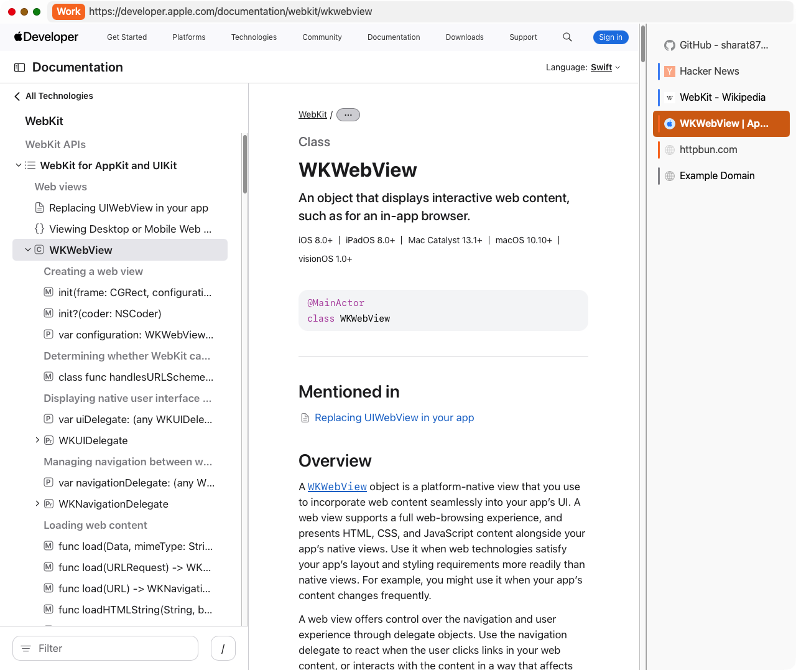

#  Twinkle

My minimal web browser for macOS, built on the system's WebKit. Vibed just for myself; I expect it to be "finished" after a few weeks of use, so it's not looking for features.

- Built on system WebKit. Not Chromium.
- Light and fast.
- HTTPS first. If that fails, only then HTTP.
- Containers with distinct cookiejars, like Firefox.
- MRU tab switching like Firefox, SublimeText, iTerm2 etc.
- Hints mode, like Pentadactyl or Vimium, with Cmd-I.
- Address bar in monospace font, so look-alike letters are easy to tell apart.
- Settings and bookmarks are JSON files, no extra UI. Auto-reload on focusing Twinkle.
- Window title has the URL host like `Title (host)` so KeepassXC's auto-type can work well.
- Everything is under the menubar. No command palette & toolbar icon buttons. Use a fuzzy searcher for menubar via Alfred or Raycast.
- Shortcuts configurable in macOS settings.
- Permissions always denied. Camera, mic, screen capture etc. This may change later, but not present today.
- Tabs on the right side.
- No devtools. If you need, use another browser for that.
- No MCP. There's AppleScript support, which your agent can use.
- Idle tabs unload to keep a low footprint.
- Shows response status code, like `200 OK` next to address bar.
- Of course, ad & tracker blocking.

<picture>
  <source media="(prefers-color-scheme: dark)" srcset="docs/screenshot-dark.png">
  
</picture>

## Build and run

No packaged versions for now. Build and perhaps vibe more things yourself. You can ask your agent to build.

Needs macOS 14+ and Swift 6 (the Command Line Tools are enough; Xcode isn't needed).

Twinkle runs in the App Sandbox, signed with a code signing identity of your own, so macOS keeps its cookies, site data and history from other apps (they'd otherwise be plain files any script could read). Make the identity once per Mac:

```sh
scripts/make-signing-identity.sh   # "Twinkle Local Signing", in your login keychain
```

The first build then asks for your login password so `codesign` can use it; choose Always Allow. The private key stays in your keychain; never copy or commit it. Without the identity `./build.sh` won't build, and an unsandboxed or ad-hoc signed Twinkle won't start.

```sh
./build.sh            # release build → build/Twinkle.app
./build.sh debug run  # debug build, then (re)launch it
./test.sh             # tests for TwinkleCore
```

Twinkle › Restart Twinkle quits and opens the app again, so a rebuild with `./build.sh` takes effect when you're ready.

`--profile <folder>` runs a separate Twinkle that keeps everything in that folder, with its own cookies and filter lists, for testing without touching your own: `./build.sh release run --profile <folder>`. The sandbox only allows profile folders under `/tmp`.

`--unsafe` (only with `--profile`) builds `build/Twinkle Unsafe.app` instead, ad-hoc signed so no password is asked for: handy for agents and scripts. It's still sandboxed, but as a different app (`dev.twinkle.Twinkle.unsafe`) with its own container, so it can't reach your Twinkle's cookies or data, and it won't start without a profile.

## Files

Everything lives in Twinkle's sandbox container, in `~/Library/Containers/dev.twinkle.Twinkle/Data/Library/Application Support/Twinkle/`. The first time another app (your text editor, say) opens one of these, macOS asks whether it may access Twinkle's data. An unsandboxed Twinkle's files, from `~/Library/Application Support/Twinkle/` and `~/Library/WebKit/dev.twinkle.Twinkle/`, are moved in at the first sandboxed launch.

| File | What |
|---|---|
| `settings.json` | Downloads folder, filter lists, your containers, and settings per domain (`zoom`, `adBlockingOff`, `container`). Missing keys take defaults. |
| `session.json` | Open tabs, restored at launch. |
| `tab-history/` | Each open tab's back/forward list (with scroll positions and form contents), one file per tab named by its id in `session.json`, so tabs come back with their Back and Forward. |
| `filters/custom.txt` | Your own filter rules. |
| `filters/cache/` | Downloaded filter lists. |
| `bookmarks.json` | Bookmarks (from Safari), searched by the address bar. |
| `history.sqlite` | Pages visited (address, title, visits, last visit), kept `historyDays`. Not written for temporary containers. History › Clear History empties it. |
| `favicons/` | Site icons for the tab list, one small PNG per host. Not written for temporary containers. |

The Twinkle menu opens each of these. WebKit keeps each container's site data in the container's `Library/WebKit/`. When a container is gone from `settings.json`, its cookies and site data are deleted at the next launch.

Downloads can only go to `~/Downloads` (or a folder in it): that's all the sandbox lets Twinkle write.

### settings.json

```json
{
  "downloadsDirectory": "~/Downloads",
  "filterLists": [
    "https://easylist.to/easylist/easylist.txt",
    "https://easylist.to/easylist/easyprivacy.txt"
  ],
  "filterListRefreshDays": 4,
  "unloadTabsAfterMinutes": 30,
  "historyDays": 180,
  "monospaceFont": "Monaco",
  "monospaceFontSize": 18
}
```

Searches go to DuckDuckGo, and there's no search setting: use DuckDuckGo's `!bang`s (`!g swift`, `! swift` for the first result) or, for keyword searches, Alfred or Raycast.

`domains` holds settings per domain (`zoom`, which ⌘+ and ⌘- remember, `adBlockingOff`, and `container` by container name, or `"none"` for no container): `"domains": {"example.com": {"zoom": 1.25, "adBlockingOff": true, "container": "Personal"}}`. An entry covers its subdomains, the most specific one winning. `"*"` sets defaults across all sites: `"*": {"adBlockingOff": true}` turns ad blocking off everywhere except sites with `"adBlockingOff": false`, and `"*": {"zoom": 1.1}` sets a default zoom level for all URLs.

`unloadTabsAfterMinutes: 0` keeps every tab loaded. `historyDays: 0` keeps no history. `monospaceFont` and `monospaceFontSize` (CSS pixels) are what pages asking for `monospace` get, and what plain text and JSON are shown in; they apply to tabs opened after the change. The window title ends in ` (host)` so KeePassXC auto-type can match on it.

### Importing from Safari

File › Import from Safari… copies Safari's history, bookmarks and cookies in. macOS keeps those behind Full Disk Access, so first add Twinkle under System Settings › Privacy & Security › Full Disk Access (the import offers to open it), quit and reopen Twinkle, and import. Turn the access off again afterwards if you like. Twinkle is signed ad hoc, so a rebuild in between makes macOS treat it as a different app.

- History is merged into `history.sqlite`: visits add up, pages older than `historyDays` are left out.
- Bookmarks go into `bookmarks.json` (title, address, folder), which the address bar searches above history. There's no bookmarks bar; edit the file to change them.
- Cookies go into the container their site always opens in, or no container. Expired ones are skipped.

Running it again only adds what's new.

### The address bar

Type and suggestions appear under the field: open tabs and history, matched fuzzily like Sublime Text, so the letters need only appear in order (`ghpul` finds github.com/…/pulls, `devswui` the SwiftUI docs). Matches that start words or run together rank higher, then pages visited often and lately, and site roots before deep links. Addresses are matched without their `?query`, so tracking parameters don't match everything; search result pages still match by title.

When what you type is the start of an address you've visited, it's completed inline (`git` → `git|hub.com`); keep typing to replace the completion, ⌫ to drop it.

↑/↓ choose, ↩ opens (or switches to an open tab), ⌘↩ opens in a new tab, ⇥ puts the chosen address in the field to edit, ⎋ closes. The first row is always what the field says: the completed address, or a search.

History is searched in memory (read from `history.sqlite` once), so typing never waits on the disk: about 2 ms a keystroke with the list redrawn, and under 10 ms to search 50,000 pages.

### Containers

They're the `containers` object in settings.json: each container name is a key, and its value has `id` (keys the cookie jar; keep it), `color`, and optional `appleScriptEnabled` (defaults to `false`). Containers are shown alphabetically by name. Existing array-form files are still accepted. Without the key there are no containers, and none of their data is deleted.

```json
{
  "containers": {
    "Personal": { "id": "E00727EE-…", "color": "#3B82F6" },
    "Work": { "id": "8BB4415B-…", "color": "#F97316" }
  },
  "domains": {
    "example.com": { "container": "Personal" },
    "mail.example.com": { "container": "Work" },
    "corp.io": { "container": "Work" },
    "news.example": { "container": "none" }
  }
}
```

A `domains` entry covers its subdomains, and the most specific entry wins: here `mail.example.com` opens in Work and the rest of `example.com` in Personal. `"none"` means no container (so no container can be called that), and `""` undoes a parent domain's assignment, letting a subdomain open in whichever container its tab is in. Tools › Always Open This Site In sets it from the menu: No Container, a container, or Any Container to unassign. A link or redirect to an assigned site moves to its container: a fresh tab is replaced, a tab with history keeps its page and the site opens beside it. Form posts, reloads, back/forward and pop-ups (sign-in windows talk to their opener) never move. Nor does a tab you put somewhere yourself with Reopen in Container, Duplicate, Reopen Closed Tab or a restored session.

### AppleScript

A window exposes `tabs` and `active tab`, with tab properties `id`, `URL`, `title`, `name` (alias of `title`), `container` (its name, or empty), and `loading`. Any tab's properties can be read, Chromium-style, which is what launchers like Alfred ask for:

```applescript
tell application "Twinkle" to get {URL, title} of active tab of front window
```

Everything else (opening tabs, setting a tab's `URL`, `close`, `do JavaScript`) works only in containers with `"appleScriptEnabled": true` in settings.json, and in temporary containers a script made. A script can't touch your other containers' pages or cookies, and sites assigned to other containers don't pull its tabs out.

```applescript
tell application "Twinkle"
  set t to new tab "https://example.com"                 -- a new temporary container
  set u to new tab "https://example.org" in container "Agent"
  do JavaScript "return document.title" in t             -- an async function body: return, await
  set URL of t to "https://example.net"
  close t
end tell
```

`search "query"` (optionally `limit 10`; default 30) searches bookmarks and history as the address bar does, best first, and gives each page's `title`, `URL` and whether it's `bookmarked`. Like reading tabs, it's allowed for any script macOS lets in.

`new tab` opens in the background (requiring a full URL with scheme); pass `in container` an AppleScript-enabled container name (case-insensitive) or a script-created temporary container name (like `"Temporary 2"`, from `container of t`) to share its cookies. `do JavaScript` runs in the page and returns text, numbers and booleans as they are, anything else as JSON text; pages' Content Security Policies don't apply. macOS asks once per app (Terminal, your agent) before it may script Twinkle.

### Alfred

`ti <query>` in Alfred searches Twinkle's bookmarks (★) and history (🕒), using `search` above; ↩ opens the page in Twinkle, ⌘C copies its address. Twinkle has to be running. Build and import it with:

```sh
scripts/make-alfred-workflow.sh install   # build/Twinkle.alfredworkflow, opened in Alfred
```

The workflow lives in `alfred/`; run that again after changing it, and Alfred offers to update the one it has. Its `bundleid` variable picks the Twinkle to ask (`dev.twinkle.Twinkle.unsafe` for the test build). macOS asks once before Alfred may script Twinkle.

## Keys

| | |
|---|---|
| `⌘T` new tab (same container) · `⌃⌘0` new tab, no container · `⌃⌘1`–`9` new tab in container · `⌥⌘T` new temporary container | `⌘W` close · `⇧⌘T` reopen closed tab · `⌘P` print (or Save as PDF, from the print panel) |
| `⌘L` address · `⌘F` find · `⌘G` / `⇧⌘G` next / previous | `⌘[` / `⌘]` back / forward · `⌘E` the tab's back/forward list (↑/↓ and Return, or click) · `⌘R` reload · `⌥⌘R` reload from origin |
| `⌃Tab` recently used tabs (hold `⌃`, tap Tab to go further back, `⇧` reverses, Escape cancels) · `⇧⌘]` / `⇧⌘[` next / previous tab · `⌘1`–`⌘9` jump · `⇧⌘↑` / `⇧⌘↓` move tab up / down | `⌘+` (or `⌘=`) / `⌘-` / `⌘0` zoom, remembered per site · `⌃⌘S` tab list · `⇧⌘N` new container |
| `⌥⇧⌘⌫` clear cookies and data for this site (Tools menu): everything the tab's container holds for the site, then a reload. For sign-ins that get stuck, like AWS. | `⇧⌘C` copy the page's address · `⌥⇧⌘C` copy it as a Markdown link, `[title](address)` |

Drag the blank space in the tab list (above, around or below the tabs) to move the window.

⌘-click or middle-click a link to open it in a background tab in the same container; add ⇧ to switch to it. Middle-click a tab to close it. Right-click a tab to reopen it in another container (or a new temporary one), or to unload it now. Right-click a page › Inspect Element opens Safari's Web Inspector.

## Code

```
Sources/TwinkleCore/   Foundation only: settings, containers, session, address
                       parsing, window titles, the filter-list converter,
                       history and its fuzzy search.
                       Nothing Mac-specific, so another platform's shell
                       (e.g. WebKitGTK on Linux) could reuse it.
Sources/Twinkle/       The macOS app (AppKit + WKWebView).
  BrowserWindowController  window, address row, sidebar, find bar, session
  Tab                      one web view: navigation, pop-ups, downloads, dialogs, permissions
  Blocker                  filter lists → compiled WKContentRuleLists
  AppState                 settings/containers files, one data store per container
  Downloads                WKDownload to the downloads folder
  Favicons                 site icons, fetched without cookies
  JSONViewer               pretty-prints JSON responses
  AddressSuggestions       the address bar's dropdown
  Debug                    inspection hook used by debug.sh
scripts/make-icon.swift    draws the app icon (build.sh runs it)
alfred/                    the Alfred workflow (scripts/make-alfred-workflow.sh packs it)
```

The content-blocker JSON that `FilterConverter` produces is WebKit's format, which WebKitGTK also reads, and the data files are plain JSON. Porting means writing a new shell, not translating data.

### Looking inside a running Twinkle

`./debug.sh` asks the running app to write `state.json` (tabs, titles, URLs, loading state), `text.json` (each loaded tab's text), `window.png` and `page.png` to Twinkle's folder in its container (`…/Twinkle/debug/`), then prints the state (with `TWINKLE_PROFILE=<folder>`, the `--profile` Twinkle and `<folder>/debug/`). `./debug.sh open <url> [container]` opens a tab (`temporary` for a new temporary container) and `./debug.sh select <index>` brings one to the front. This works without Screen Recording permission. The page snapshot needs the window to be visible on screen.

## Licence

MIT. See [LICENSE](LICENSE).
